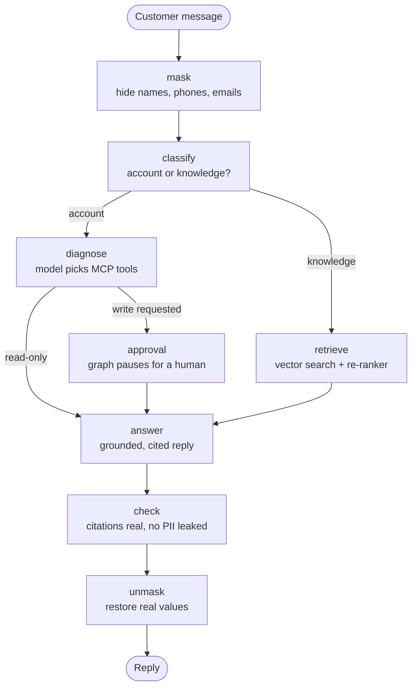

# Telecom Support Agent

[](https://github.com/CelesteJain/telecom-support-agent/actions/workflows/tests.yaml)
[](https://github.com/CelesteJain/telecom-support-agent/actions/workflows/docker.yaml)

A customer-support agent for a fictional telecom company. It answers how-to questions from
help articles (RAG), looks up account data through MCP tools, and asks a human to approve
anything that changes data. Personal data is masked before it reaches any model, and every
answer is checked in code before the customer sees it. Runs fully locally on free tools.
All data is synthetic.

## What it does

- **Knowledge questions:** "My wifi keeps dropping" returns a short, cited answer from the help articles.
- **Account questions:** "Check the line for C002" makes the model call read-only MCP tools.
- **Write actions:** "Please open a ticket" pauses the workflow until a human approves. Nothing is written before that.
- **Safety:** PII masking, a citation and PII check on every answer, and a fallback reply when nothing relevant is found.

## Architecture



The diagram is generated from the graph with `python -m scripts.make_diagram`.
Outcomes of write actions (ticket opened, rejected, failed) are written by code, not by the model.

| Part | Choice |
| --- | --- |
| Workflow | LangGraph (state, routing, pause and resume with a checkpointer) |
| LLM | qwen2.5:7b through Ollama (free, local, CPU) |
| Retrieval | all-MiniLM-L6-v2 embeddings, Chroma, cross-encoder re-ranker |
| Tools | MCP server (FastMCP) with 3 tools; read-only tools run directly |
| PII | Presidio + spaCy, plus a custom UK-mobile recognizer |
| Service | FastAPI: `/chat`, `/approve`, `/health` |
| Quality | pytest (21 tests), eval suite (17 golden questions), GitHub Actions, Docker |

## Results

Eval suite on 17 golden questions (local qwen2.5:7b, CPU):

| | First run | Prompt rules removed | Final |
| --- | --- | --- | --- |
| Cases fully passed | 16/17 | 6/17 | **17/17** |
| Writes without approval | 0 | 0 | 0 |
| Forbidden data leaked | 0 | 0 | 0 |
| Avg latency per answer | 24.7s | 35.8s | 24.2s |

- **Hard vs soft controls:** with the prompt rules removed, answers got worse (the answer
  check blocked 10 of 17), but no unsafe output got through. Prompts decide how helpful the
  agent is; code decides how safe it is.
- **Two bugs the evals found:** a retrieval threshold I had guessed (fixed by calibrating
  it from measured re-ranker scores), and the model mis-citing ticket results (1 of 5 runs;
  fixed by building action replies in code, then 10/10).
- **Re-ranker:** no gain on this small corpus (6/7 vs 6/7 right article first), so I would
  re-test it on a larger one.

Details and the full build story are in [docs/build-log.md](docs/build-log.md).

## Run it

Needs Python 3.12 or newer and [Ollama](https://ollama.com).

```bash
ollama pull qwen2.5:7b
python -m venv .venv && .venv\Scripts\activate     # Windows
pip install -r requirements.txt
python -m spacy download en_core_web_lg
python rag/ingest.py                                # builds the search index
uvicorn api.main:app                                # then open http://127.0.0.1:8000/docs
```

`requirements.txt` is a Windows freeze. On Linux or macOS, install PyTorch first and then
`requirements-docker.txt`, or use Docker:

```bash
docker build -t telecom-agent .
docker run --rm -p 8000:8000 -e OLLAMA_HOST=http://host.docker.internal:11434 telecom-agent
```

Try it on the `/docs` page: send `{"message": "Customer C002 has had no roaming. Please open a ticket."}`
to `POST /chat`. You get `"status": "needs_approval"` and a `thread_id`; send that to
`POST /approve` with `"approve": true`.

```bash
python -m pytest -q                      # 21 unit tests (no model needed)
python -m evals.run_evals retrieval      # search only
python -m evals.run_evals graph          # full agent, about 10 minutes on CPU
```

## Project layout

```
agent/        LangGraph workflow, tool loop, guardrails
api/          FastAPI service
rag/          ingestion and search
mcp_server/   MCP tools (lookup_customer, check_line_status, open_ticket)
evals/        golden questions and the eval runner
tests/        unit tests
data/         synthetic customers and 30 help articles
docs/         build log and generated architecture diagram
```

## Known limitations

- Saved graph state is in memory, so a restart loses paused approvals (production: a database-backed checkpointer).
- `/approve` has no authentication; the approver must be a logged-in staff member, not the customer.
- The container runs as root.
- The eval set is small (17 questions, mostly single runs) and its invented-number detector only sees multi-digit numbers.
- A 7B model on CPU takes 10 to 60 seconds per answer; a hosted model would be faster and stronger at tool calling.

## Key takeaways

- **Enforce safety in code, not in the prompt.** Prompt rules can be overridden by injection or
  ignored by the model. Write actions are gated by a human-approval step (LangGraph interrupt with
  a checkpointer), and every answer passes a code-level check for citations and PII before release.
  With all prompt rules removed, no unsafe output was released, but 10 of 17 answers were blocked,
  so prompts decide helpfulness and code decides safety.
- **Evaluate with repeated runs, not single examples.** LLM output varies between runs: one ticket
  reply mis-cited its source in 1 of 5 runs, and the classifier once mislabelled a request. An
  automated suite (17 golden cases, 21 unit tests) caught both and verified the fixes.
- **Calibrate thresholds from data.** A retrieval cut-off I had assumed (min_score 0.0) silently
  discarded valid results, because cross-encoder scores are raw logits and PII placeholders lowered
  them. I replaced it with a value derived from measured scores (relevant 6.2 to 10.8, off-topic
  about -11).
- **Keep the model out of deterministic paths.** Replies to write actions (ticket opened, rejected,
  failed) are built by code from the tool result. This removed the mis-citation failure (10/10 on
  re-run) and cut latency for those cases from about 15 to 30s to about 8s.
- **Minimise the data each component sees.** Personal data is masked before any model call or
  search, tools return only the fields they need, and tool use is limited by an allow-list and a
  round cap. Customer IDs are deliberately not masked, because the tools require them.