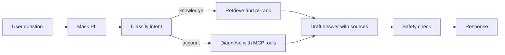

# Telecom Support Agent

A customer support assistant that decides whether a question needs a knowledge-base answer or an account lookup, calls tools through MCP, cites its sources, masks personal data before any model call, and is scored by an automated test suite.

It runs entirely on a laptop with free, local models and synthetic data. No paid services and no real customer data.

**Status: in progress.** See the checklist below.

## Planned architecture



## Tech stack

- Python, Ollama (`qwen2.5:7b`, local model)
- LangGraph for the agent workflow
- Chroma and sentence-transformers for retrieval, with a cross-encoder re-ranker
- MCP (Model Context Protocol) server for the account tools
- Presidio for PII masking
- FastAPI, pytest, Docker, GitHub Actions

## Progress

- [x] Step 1: Environment setup and local model check
- [x] Step 2: Synthetic data (help articles and fake customers)
- [x] Step 3: RAG search with re-ranking
- [x] Step 4: MCP tool server
- [x] Step 5: PII guardrails
- [ ] Step 6: LangGraph agent
- [ ] Step 7: FastAPI service
- [ ] Step 8: Evaluation suite
- [ ] Step 9: Docker and CI
- [ ] Step 10: Final write-up and demo

## Setup

```
git clone https://github.com/CelesteJain/telecom-support-agent.git
cd telecom-support-agent
python -m venv .venv
.venv\Scripts\activate        # Mac/Linux: source .venv/bin/activate
pip install -r requirements.txt
ollama pull qwen2.5:7b
python test_ollama.py
```

## Early findings

Measured on a Windows laptop with no GPU (Ollama reports 100% CPU):

- The first request after the model is idle took about 10 seconds, mostly loading the 5.1 GB model into memory.
- Asked to greet in exactly five words, the models(qwen2.5:7b, llama3.latest) returned 4 and 6 words. Models cannot reliably count, so I will not trust output without automated checks. This is why the project includes an evaluation suite. Evaluation results will be added here soon.

## What I learned

### Step 2: Synthetic data

- **Why synthetic data:** Customer data and internal policies are confidential. Sending them to a model risks leaking identities, enables social engineering, and may leave the organisation if a hosted model is used. Fake data (reserved fictional phone numbers, example.com emails) makes the project safe to publish.
- **Why models miss exact constraints:** A model predicts text one token at a time and has no built-in counter, so "exactly five words" is only approximated. Rules that can be checked should be checked by code, not trusted to the model. This is why the project has an automated evaluation suite.
- **Resumable scripts:** The article generator skips files that already exist. On a slow CPU each article takes 30 to 60 seconds, so a crash or a stop doesn't force redoing finished work, and good files are never overwritten.

### Step 3: Retrieval with re-ranking

- **Pipeline:** 30 articles are split into 500-character chunks with 50 characters of overlap, giving 84 chunks. They are embedded with `all-MiniLM-L6-v2` and stored in Chroma. A query fetches 20 candidates by vector similarity, then a cross-encoder re-ranker keeps the best 4.
- **Finding: chunks lose their topic.** Only the first chunk of an article contains its title. On the test question "my wifi keeps cutting out", the re-ranker pulled in chunks from unrelated SIM and router-lights articles (scores −6.9 and −7.4 against 3.3 for the right chunk). Adding the article title to every chunk before embedding fixed it: three chunks from the correct article scored 3.3 to 4.6, with a gap of about 10 points to the next, irrelevant one.
- **Minimum score:** The system returns fewer than 4 results, or none, when no chunk scores above the threshold, so the agent can say it doesn't know instead of guessing. The threshold of 0 is a starting point to be validated by the evaluation suite.
- **Caveat:** These results come from a single question and a small corpus of 84 chunks. A re-ranker is not automatically better than vector search alone. The comparison will be measured across 30 labelled questions in Step 8.

**Concepts, in my own words**

- **Embedding:** A model turns each chunk of text into a vector, a list of numbers (384 for `all-MiniLM-L6-v2`). Text with similar meaning gets nearby vectors, so a question can be matched to chunks by meaning rather than exact words.
- **Chunking and overlap:** Embedding a whole article blurs several topics into one vector and can exceed the model's input limit. Chunks keep each vector focused. Overlap stops a sentence or idea from being cut at a chunk boundary.
- **Two-stage retrieval:** Vector search is fast but compares the question and chunks separately. A cross-encoder re-ranker reads the question and chunk together, so it is more accurate but too slow for the whole corpus. I fetch 20 candidates with the fast method, then re-rank to the best 4. A wider candidate set means the right chunk is not missed if vector search ranks it lower, at the cost of extra latency per query.

### Step 4: MCP tool server

Three tools served over MCP (stdio transport), tested with a small client script:

| Tool | Type | What it returns |
| --- | --- | --- |
| `lookup_customer` | Read | Plan and open incident. No name, email or phone. |
| `check_line_status` | Read | Line status (`active`, `suspended_unpaid`, `no_signal`, `roaming_blocked`, `sim_not_activated`) |
| `open_ticket` | Write | A new ticket ID. Requires human approval in the agent (Step 6). |

- **Least data:** The tools return only what the agent needs, so personal contact details never reach the model.
- **Server-side validation:** An unknown customer ID returns a clean error instead of crashing.
- **Dependency pinning:** My first install pulled `mcp` 2.x, where `FastMCP` was renamed `MCPServer`. The server crashed on import and the client only reported "Connection closed". I pinned `mcp<2` and recorded exact versions in `requirements.txt`. Fast-moving AI libraries make breaking changes, so versions must be pinned.
- **Debugging approach:** When a client reports a vague connection error, run the server directly to see its own error.

**Concepts, in my own words**

- **MCP:** A standard way for AI applications to discover and call tools. A server advertises its tools (names, descriptions, inputs); a client lists them, shows them to the model and runs the calls. Unlike a plain API, the server describes itself in a form a model can read.
- **The model asks, my code does:** The model never runs a tool. It outputs a request naming the tool and its inputs. My code runs the function through the MCP client and returns the result to the model.
- **Test client vs agent:** In my test script I chose the calls in advance. In the agent, the model will choose the tool and inputs at runtime from the question and the tool descriptions.
- **`list_tools`:** Returns each tool's name, description (from the docstring) and input fields, which the agent passes to the model.

### Step 5: PII guardrails

Three guardrails around the model:

1. **Before the model:** personal data in the customer's message is replaced with numbered placeholders (`<PERSON_1>`, `<PHONE_NUMBER_1>`). The lookup table stays in my program's memory and is never sent to the model. The real values are restored only in the reply to the same customer.
2. **After the model:** the answer must cite a retrieved source.
3. **After the model:** the answer must not contain personal data.

Measured on 20 synthetic customers, with 8 automated tests passing:

| Check | Result |
| --- | --- |
| Names masked | 19 / 20 |
| Phone numbers masked | 20 / 20 |
| Emails masked | 20 / 20 |
| Customer IDs kept (needed by the tools) | 20 / 20 |
| Ordinary support sentences wrongly changed | 0 / 3 |

**Findings**

- **Built-in detection missed my own data format.** The UK mobile numbers in my fake data come from a range reserved for fiction, so Presidio's phone detector treated them as invalid and ignored them. I added a custom pattern recogniser, after which all 20 were caught. Always test a detector on your own data.
- **Names are harder than patterns.** Emails and phone numbers follow fixed shapes, so pattern matching is reliable. Names are found by a statistical language model that guesses from context. It missed "Mason Brown", probably because both words are also ordinary words (I have not confirmed this). Masking reduces risk but does not remove it, so the design uses several layers: minimal data from the tools (Step 4), masking before the model, and checks on the answer.

**Concepts, in my own words**

- **Guardrail:** a check around the model, before or after it, that keeps its behaviour safe and as intended. Masking personal data and requiring a cited source are both guardrails.
- **Placeholders, not deletion:** the model sees `<PERSON_1>`, so it can still write a natural reply. My own code, not the model, puts the real value back afterwards.
- **Patterns vs a trained model:** emails and phone formats can be matched with patterns. Names have no fixed shape, so a trained model recognises them from context and can make mistakes.

### Step 6a: A minimal LangGraph agent

The first version of the agent is a straight line: `mask` hides personal data, `answer` asks the local model, and `unmask` restores the real values in the reply.


- **LangGraph basics:** The *state* is one shared dictionary that every step reads and writes. A *node* is a Python function that returns only the fields it changed. An *edge* sets which node runs next.
- **Guardrail check:** The line the model received contained `<PERSON_1>` and `<PHONE_NUMBER_1>` instead of the real values, and the real values were restored only in the reply to the customer.
- **Honest note:** For a straight line, plain Python would do the same job in four lines. I used LangGraph because the next steps add branching (6b), a tool-calling loop (6d) and a pause for human approval (6e), which are the things a graph handles well.

### Step 6b: Classify and branch

The agent now decides what kind of question it is dealing with before it does anything else. A `classify` node asks the model for one word, `knowledge` (general troubleshooting) or `account` (about the customer's own line, bill or ticket). A conditional edge reads that word from the state and routes to `retrieve` or `diagnose`.

- **Result:** 5 of 5 on a small set of test questions (3 knowledge, 2 account). This is a tiny sample, so it shows the wiring works, not that the classifier is reliable. The full evaluation in Step 8 will use many more questions, including ambiguous ones.
- **Settings:** `temperature` 0 so the same question gets the same classification, and a 5-token limit because only one word is needed, which is faster on a CPU.
- **Defensive parsing:** The routing table only accepts exact values, but models do not always follow "reply with one word". `parse_intent` reads the reply, extracts a valid value, and defaults to `knowledge` when unclear, so the graph never receives an unexpected value.
- **Finding:** With no tools or retrieved material yet, the model answered an account question with "I'll check on line C002 right away", promising an action it cannot perform. A model writes plausible text whether or not it can act. Retrieval (6c) and tools (6d) are the fix, and a check on the final answer (6e) is the safety net.
- **Extra test:** "My bill looks wrong", an account question with no ID, was classified as `account`, as expected. The model then asked the customer for their account number.
- **Why the model behaves this way:** A language model predicts the most plausible next text. Trained on large amounts of text, including support conversations, and tuned to be a helpful assistant, it writes what a good support agent typically writes: "I'll check right away" and "Can you give me your account number?". It does not know what it is actually able to do. The false promise and the useful question come from the same mechanism, so the fix is to ground it with retrieved material and tool results, instruct it clearly, and check its answers.

### Step 6c: Grounded answers with citations

The `retrieve` node now searches the help articles (with the masked question) and the `answer` node builds a prompt from three parts: rules (system prompt), the retrieved passages labelled with their source files, and the question. If search finds nothing above the minimum score, the model is not called and a fixed reply is returned.

Results from three test questions:

| Question | Behaviour |
| --- | --- |
| "My wifi keeps cutting out" | Numbered answer matching `wifi-keeps-dropping.md`, with a citation |
| "How do I make pasta carbonara?" | No sources found, fixed reply, model not called |
| "...check the line for C002?" | "I can't look up account details yet." Tools come in 6d |

**Findings**

- **Grounding fixed the false promise.** In 6b the model said "I'll check right away". With rules, context and the fallback, it no longer claims actions it cannot take.
- **Prompt rules are soft, code is hard.** The prompt asked for a citation after each fact, but the model cited once at the end. A fixed reply in code is a guarantee, while a prompt instruction is a request. A code check of the citations is planned for 6e.
- **Duplicate sources:** three chunks from one article show the same file three times. Showing each source once is a small improvement.

**Concepts, in my own words**

- **Grounding:** the model does not know my private help articles, so retrieval supplies them and the model writes the answer from them.
- **Safer fallback:** when nothing is found, the code returns a fixed reply, so the model never improvises.
- **Masked search:** the question is masked before the search as well, so personal data does not reach any other component.

### Step 6d: MCP tool calling

The `diagnose` node now lets the model use the read-only MCP tools (`lookup_customer`, `check_line_status`) in a loop: the model requests a tool, my code runs it through the MCP client, the result goes back to the model, and this repeats until the model stops asking or a round limit is hit. The collected tool results go into the same `{source, text}` context as the help-article passages, and the `answer` node writes the reply with citations like `[tool:check_line_status]`.

| Question | Behaviour |
| --- | --- |
| "...check the line for C002?" | Called `check_line_status`, answered `roaming_blocked`, cited the tool |
| "What plan is customer C001 on?" | Called `lookup_customer`, answered Unlimited 5G, cited the tool |
| "...check the line for C999?" | Tool returned "No customer with id C999"; the agent reported it honestly |
| "My bill looks wrong" | No tool called; asked for the customer ID |

**Design choices**

- **Least privilege:** only read-only tools are offered to the model. `open_ticket` changes data and stays hidden until a human-approval step exists (6e).
- **Defence in depth:** even for offered tools, the tool name is checked again in code before running, in case the model invents a name or is manipulated by a malicious message (prompt injection).
- **Failures become context:** a tool error is passed to the answer step instead of crashing the agent.
- **Round limit:** the loop stops after 4 rounds.
- **Two stages:** the model first gathers facts with tools, then the `answer` node writes the reply under the same grounding rules as for help articles.

**Findings and limitations**

- On the first test, the model added "roaming services are disabled", which was not in the tool result. The answer was grounded but embellished. The evaluation in Step 8 will measure how often answers stay inside their sources.
- The MCP server is started fresh for every question (`asyncio.run`), which adds latency. A production system would keep the connection open.
- Four test questions are a small sample. Reliability of tool use will be measured in Step 8.

**Concepts, in my own words**

- **Tool calling:** the model sends a request containing a tool name and inputs. My agent code runs it through the MCP client, and the function executes in the MCP server. The result goes back to the model as a `tool` message. The model never talks to the MCP server directly.
- **How the model knows the tools:** my code asks the MCP server for its tool list and passes the names, descriptions and inputs to the model with each request. The docstrings are what the model reads.