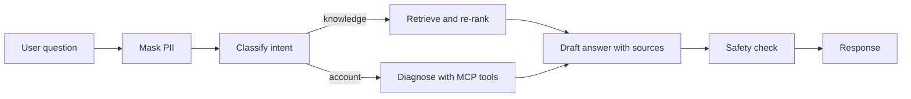

# Telecom Support Agent

A customer support assistant that decides whether a question needs a knowledge-base answer or an account lookup, calls tools through MCP, cites its sources, masks personal data before any model call, and is scored by an automated test suite.

It runs entirely on a laptop with free, local models and synthetic data. No paid services and no real customer data.

**Status: in progress.** See the checklist below.

## Planned architecture



## Tech stack

- Python, Ollama (`qwen2.5:7b`, local model)
- LangGraph for the agent workflow
- Chroma and sentence-transformers for retrieval, with a cross-encoder re-ranker
- MCP (Model Context Protocol) server for the account tools
- Presidio for PII masking
- FastAPI, pytest, Docker, GitHub Actions

## Progress

- [x] Step 1: Environment setup and local model check
- [x] Step 2: Synthetic data (help articles and fake customers)
- [x] Step 3: RAG search with re-ranking
- [ ] Step 4: MCP tool server
- [ ] Step 5: PII guardrails
- [ ] Step 6: LangGraph agent
- [ ] Step 7: FastAPI service
- [ ] Step 8: Evaluation suite
- [ ] Step 9: Docker and CI
- [ ] Step 10: Final write-up and demo

## Setup

```
git clone https://github.com/CelesteJain/telecom-support-agent.git
cd telecom-support-agent
python -m venv .venv
.venv\Scripts\activate        # Mac/Linux: source .venv/bin/activate
pip install -r requirements.txt
ollama pull qwen2.5:7b
python test_ollama.py
```

## Early findings

Measured on a Windows laptop with no GPU (Ollama reports 100% CPU):

- The first request after the model is idle took about 10 seconds, mostly loading the 5.1 GB model into memory.
- Asked to greet in exactly five words, the models(qwen2.5:7b, llama3.latest) returned 4 and 6 words. Models cannot reliably count, so I will not trust output without automated checks. This is why the project includes an evaluation suite. Evaluation results will be added here soon.

## What I learned

### Step 2: Synthetic data

- **Why synthetic data:** Customer data and internal policies are confidential. Sending them to a model risks leaking identities, enables social engineering, and may leave the organisation if a hosted model is used. Fake data (reserved fictional phone numbers, example.com emails) makes the project safe to publish.
- **Why models miss exact constraints:** A model predicts text one token at a time and has no built-in counter, so "exactly five words" is only approximated. Rules that can be checked should be checked by code, not trusted to the model. This is why the project has an automated evaluation suite.
- **Resumable scripts:** The article generator skips files that already exist. On a slow CPU each article takes 30 to 60 seconds, so a crash or a stop doesn't force redoing finished work, and good files are never overwritten.

### Step 3: Retrieval with re-ranking

- **Pipeline:** 30 articles are split into 500-character chunks with 50 characters of overlap, giving 84 chunks. They are embedded with `all-MiniLM-L6-v2` and stored in Chroma. A query fetches 20 candidates by vector similarity, then a cross-encoder re-ranker keeps the best 4.
- **Finding: chunks lose their topic.** Only the first chunk of an article contains its title. On the test question "my wifi keeps cutting out", the re-ranker pulled in chunks from unrelated SIM and router-lights articles (scores −6.9 and −7.4 against 3.3 for the right chunk). Adding the article title to every chunk before embedding fixed it: three chunks from the correct article scored 3.3 to 4.6, with a gap of about 10 points to the next, irrelevant one.
- **Minimum score:** The system returns fewer than 4 results, or none, when no chunk scores above the threshold, so the agent can say it doesn't know instead of guessing. The threshold of 0 is a starting point to be validated by the evaluation suite.
- **Caveat:** These results come from a single question and a small corpus of 84 chunks. A re-ranker is not automatically better than vector search alone. The comparison will be measured across 30 labelled questions in Step 8.

**Concepts, in my own words**

- **Embedding:** A model turns each chunk of text into a vector, a list of numbers (384 for `all-MiniLM-L6-v2`). Text with similar meaning gets nearby vectors, so a question can be matched to chunks by meaning rather than exact words.
- **Chunking and overlap:** Embedding a whole article blurs several topics into one vector and can exceed the model's input limit. Chunks keep each vector focused. Overlap stops a sentence or idea from being cut at a chunk boundary.
- **Two-stage retrieval:** Vector search is fast but compares the question and chunks separately. A cross-encoder re-ranker reads the question and chunk together, so it is more accurate but too slow for the whole corpus. I fetch 20 candidates with the fast method, then re-rank to the best 4. A wider candidate set means the right chunk is not missed if vector search ranks it lower, at the cost of extra latency per query.