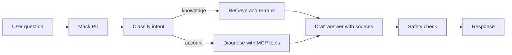

# Telecom Support Agent

A customer support assistant that decides whether a question needs a knowledge-base answer or an account lookup, calls tools through MCP, cites its sources, masks personal data before any model call, and is scored by an automated test suite.

It runs entirely on a laptop with free, local models and synthetic data. No paid services and no real customer data.

**Status: in progress.** See the checklist below.

## Planned architecture



## Tech stack

- Python, Ollama (`qwen2.5:7b`, local model)
- LangGraph for the agent workflow
- Chroma and sentence-transformers for retrieval, with a cross-encoder re-ranker
- MCP (Model Context Protocol) server for the account tools
- Presidio for PII masking
- FastAPI, pytest, Docker, GitHub Actions

## Progress

- [x] Step 1: Environment setup and local model check
- [ ] Step 2: Synthetic data (help articles and fake customers)
- [ ] Step 3: RAG search with re-ranking
- [ ] Step 4: MCP tool server
- [ ] Step 5: PII guardrails
- [ ] Step 6: LangGraph agent
- [ ] Step 7: FastAPI service
- [ ] Step 8: Evaluation suite
- [ ] Step 9: Docker and CI
- [ ] Step 10: Final write-up and demo

## Setup

```
git clone https://github.com/CelesteJain/telecom-support-agent.git
cd telecom-support-agent
python -m venv .venv
.venv\Scripts\activate        # Mac/Linux: source .venv/bin/activate
pip install -r requirements.txt
ollama pull qwen2.5:7b
python test_ollama.py
```

## Early findings

Measured on a Windows laptop with no GPU (Ollama reports 100% CPU):

- The first request after the model is idle took about 10 seconds, mostly loading the 5.1 GB model into memory.
- Asked to greet in exactly five words, the models(qwen2.5:7b, llama3.latest) returned 4 and 6 words. Models cannot reliably count, so I will not trust output without automated checks. This is why the project includes an evaluation suite. Evaluation results will be added here soon.